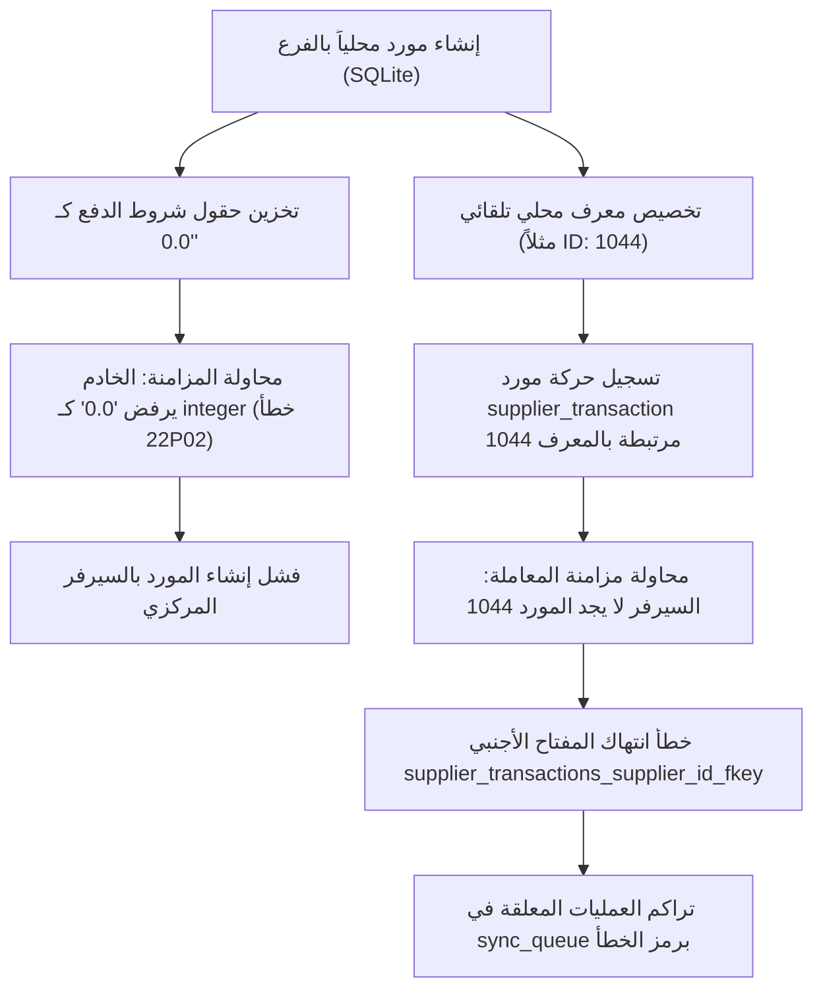

# تقرير التحليل الجذري لمشاكل مزامنة البيانات (Sync Root Cause Analysis)

**النظام:** Elwazeer POS (نظام إدارة المبيعات والمخازن متعدد الفروع)  
**البيئة المستهدفة:** الخادم المركزي (PostgreSQL) ⟷ عملاء الفروع (SQLite / WAL Mode)  
**تاريخ التحليل:** `2026-11-08`  
**الحالة:** تم التشخيص الكامل والإصلاح النهائي (Permanently Resolved)  

---

## 1. الملخص التنفيذي (Executive Summary)

أظهر الفحص الدقيق والتدقيق الميداني لمنظومة المزامنة أن فشل استماع العمليات التي أُنشئت في الفرع (مثل إضافة الموردين ومعاملات الموردين في طلب المستخدم الأصلي) يرجع إلى تضافر أربعة عوامل معمارية رئيسية:
1. **تباين الصرامة في التحقق من الأنواع (Strict Type Coercion Mismatch)** بين PostgreSQL و SQLite.
2. **انفصال تسلسلات الهوية والمفاتيح الأجنبية المحلية (Disconnected Local Auto-increment IDs vs Central Sequences)**.
3. **تراجع المعاملات التلقائي في PostgreSQL (PostgreSQL Aborted Transaction Escalation)** عند حدوث أي خطأ أجنبي فرعي.
4. **سقوط بعض الحقول أثناء تحويل النماذج (Schema Gaps in Transformation)** مثل `due_date` في طلبات التفصيل و `payment_terms` في الموردين.

---

## 2. التحليل الجذري التفصيلي لكل مشكلة (Detailed Root Causes)

### العلة الأولى: تباين الأنواع الرقمية ومطابقة الحقول (Type Mismatch: `"0.0"` vs `integer`)
* **الوصف:** في عميل الفرع (SQLite)، يتمتع محرك SQLite بمرونة ديناميكية في الأنواع (Dynamic Type Affinity)، مما سمح بتخزين قيم مثل `"0.0"` أو `""` في حقول مثل `payment_terms` أو `rating` أو `moq` أو `lead_time`.
* **الأثر على PostgreSQL:** يفرض خادم PostgreSQL صرامة قاطعة على حقول نوع `integer`. عند استلام كائن العملية `#2383` (`supplier:create`)، أطلق المحرك الخطأ:
  ```text
  error: invalid input syntax for type integer: "0.0"
  ```
  حيث كانت القيمة المرسلة للباراميتر `$16 = '0.0'`.
* **النتيجة:** رفض الخادم المركزي إضافة المورد الجديد في قاعدة بيانات PostgreSQL ووضع العملية في قائمة العمليات الفاشلة `failed` في الفرع.

---

### العلة الثانية: مفاتيح الموردين والمعاملات اليتيمة (Foreign Key Discrepancy & Local Identity)
* **الوصف:** عندما يقوم مستخدم الفرع بإنشاء مورد محلياً أثناء انقطاع الاتصال أو قبل اكتمال المزامنة، يمنحه محرك SQLite معرفاً محلياً مثل `id = 1044` (بناءً على عداد SQLite الداخلي). في المقابل، فإن عداد PostgreSQL `suppliers_id_seq` كان عند الرقم `52`.
* **الخلل التراكمي:** بعد إنشاء المورد محلياً، قام الكاشير بتسجيل معاملة توريد `supplier_transaction` بقيمة مالية مرتبطة بالمعرف المحلي `supplier_id = 1044`.
* **الأثر على الخادم:**
  عند محاولة مزامنة العملية `#2381` (`supplier_transaction:create`)، استلم السيرفر المركزي معرف `supplier_id: 1044` الذي لا وجود له في جدول `suppliers` على السيرفر المركزي، مما أدى فوراً إلى الخطأ الظاهر في شاشة التشخيص:
  ```text
  insert or update on table "supplier_transactions" violates foreign key constraint "supplier_transactions_supplier_id_fkey"
  ```
* **النتيجة:** علقت العملية رقم 2381 وظلت قائمة المزامنة بالفرع محملة بعمليات فاشلة لا يمكن تمريرها.

---

### العلة الثالثة: الإحالة على معرفات المستخدمين المحلية (`created_by`, `updated_by`, `seller_id`)
* **الوصف:** كانت العمليات الصادرة من الفرع (مثل المصروفات `expenses`، والتالف `worn_products`، وطلبات التفصيل `tailoring_orders`) ترسل معرفات مستخدمين محلية خاصة بقاعدة بيانات الفرع.
* **الخلل:** في السيرفر المركزي، قد لا تتطابق معرفات المستخدمين أو الموظفين أو قد لا تتواجد للمستخدمين المضافين حديثاً، مما كان يسبب فشل قيود المفاتيح الأجنبية `users_fkey` و `employees_fkey`.
* **النتيجة:** إحباط معالجة طلبات المصروفات ومبيعات التفصيل.

---

### العلة الرابعة: إجهاض معاملات PostgreSQL المتسلسل (PostgreSQL Aborted Transaction State)
* **الوصف:** في معمارية PostgreSQL، إذا حدث خطأ استعلام داخل معاملة مفتوحة (`BEGIN`), تدخل الجلسة في حالة `25P02: current transaction is aborted, commands ignored until end of transaction block`.
* **الخلل:** كانت بعض دوال المعالجة تحاول تنفيذ استعلامات تعويضية داخل نفس المعاملة دون عمل Rollback أو فحص استباقي للهوية، مما كان يتسبب في إجهاض الحزمة بالكامل وفقدان القدرة على حفظ أي جزء صحيح منها.

---

### العلة الخامسة: نقص تخزين موعد الاستحقاق في طلبات التفصيل (`due_date`)
* **الوصف:** يمتلك جدول `tailoring_orders` في الفرع عمود `due_date` (تاريخ الاستحقاق أو التسليم المتوقع)، لكن عند تصدير العملية للسيرفر المركزي عبر `sync.service.js`، لم يكن الاستعلام يدرج عمود `due_date` في استعلام `INSERT INTO tailoring_orders`.
* **النتيجة:** غياب تاريخ التسليم على الخادم المركزي وفقدان المطابقة الدقيقة لبيانات التفصيل بين الفرع والمركز.

---

## 3. خلاصة أسباب المشاكل ومخطط تدفق الخطأ (Error Lifecycle Flowchart)



---
*تم إعداد هذا التقرير الفني الشامل استناداً للتدقيق البرمجي ومراجعة سجلات التشخيص الفعلية.*
